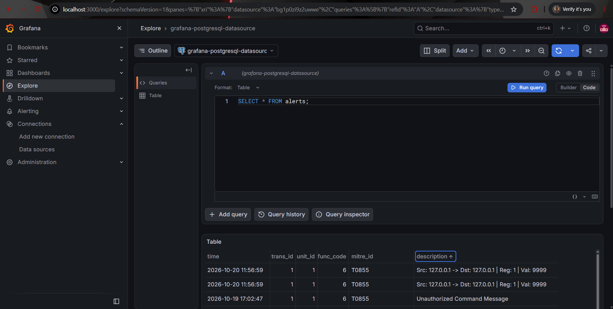

# OT-Sentinel

**Passive Industrial Threat Detection & IT/OT Telemetry Engine**

OT-Sentinel is a custom-built Deep Packet Inspection (DPI) agent designed for Industrial Control System (ICS) networks. It passively monitors Modbus TCP traffic across Purdue Levels 1 and 2, detects unauthorized setpoint manipulations, and pipes high-fidelity telemetry into an IT/OT converged Security Operations Center (SOC) dashboard.

This project was engineered to demonstrate robust packet capture under high network load, deterministic protocol dissection, and direct mapping to the **MITRE ATT&CK for ICS** framework.

## 🏗️ Architecture & Purdue Model Integration

The architecture simulates a physical plant network monitored by a passive security appliance via a spanned/mirrored network port.

1. **Purdue Level 1 & 2 (Simulated Plant Floor):** Containerized Python instances simulating a Modbus TCP PLC (TCP/502) and an HMI poller querying sensor states (Temperature, Pressure, Valve State).
2. **Purdue Level 3.5 (Passive DPI Engine):** A high-performance Go application utilizing `gopacket` to sniff network traffic natively. It parses raw Ethernet, IPv4, and TCP layers to extract Modbus payloads in real-time.
3. **Purdue Level 4/5 (SOC Telemetry):** A decoupled TimescaleDB and Grafana stack for persistent, time-series anomaly tracking and visualization.
4. **Adversary Emulation:** A localized Python attack script designed to inject unauthorized Write Single Register (`0x06`) commands to manipulate physical setpoints.

### Core Engineering Features
* **Non-Blocking Telemetry Pipeline:** The Go DPI engine utilizes buffered channels (10,000 alert capacity) and non-blocking `select` statements to decouple packet capture from database I/O. This ensures zero packet drop on the primary sniffing thread during network floods or database latency.
* **Deep Payload Dissection:** Goes beyond standard port/IP logging by tearing down the Modbus TCP payload to extract the exact physical register and injected value manipulated by the attacker.
* **Fault-Tolerant Shutdown:** Implements OS signal trapping (`SIGTERM`/`SIGINT`) to cleanly flush the in-memory alert queue to the TimescaleDB instance before termination.

## 🛠️ Technology Stack
* **Core Engine:** Go, `google/gopacket`
* **Plant Simulation & Adversary:** Python, `pymodbus`
* **Data Layer:** TimescaleDB (PostgreSQL)
* **Visualization:** Grafana
* **Infrastructure:** Docker & Docker Compose

## 🚀 Setup & Execution Instructions

### Prerequisites
* Docker Desktop & Docker Compose
* Go 1.20+
* Python 3.8+
* Npcap (for Windows host packet capture)

### 1. Initialize the Plant & SOC Infrastructure
Ensure Docker is running, then spin up the PLC, HMI, TimescaleDB, and Grafana instances.

```bash
docker-compose up -d
```

### 2. Configure the DPI Engine Environment
The engine enforces strict environment variable injection to prevent hardcoded credentials in production environments. Set these variables in your terminal session:

**Windows (PowerShell):**
```powershell
$env:DB_HOST="127.0.0.1"
$env:DB_PORT="5432"
$env:DB_USER="otsentinel"
$env:DB_PASS="securepass"
$env:DB_NAME="ot_telemetry"
```

**Linux/macOS:**
```bash
export DB_HOST="127.0.0.1"
export DB_PORT="5432"
export DB_USER="otsentinel"
export DB_PASS="securepass"
export DB_NAME="ot_telemetry"
```

### 3. Build and Run the DPI Engine
Compile the Go application and attach it to the loopback interface to intercept the Docker traffic. 

```bash
go build -o ot-sentinel-dpi .
./ot-sentinel-dpi -i "\Device\NPF_Loopback"
```
*(Note: On Linux, replace the interface flag with `-i lo`)*

### 4. Execute the Adversary Emulation
Open a separate terminal, install the Modbus dependency, and trigger the attack script to inject a MITRE T0855 (Unauthorized Command Message) violation.

```bash
pip install pymodbus==3.6.8
python adversary.py
```

### 5. View SOC Telemetry
Navigate to `http://localhost:3000` in your web browser. 
* **Credentials:** `admin` / `admin`
* Connect the PostgreSQL data source (`timescaledb:5432`, DB: `ot_telemetry`, User: `otsentinel`, Pass: `securepass`).
* Execute `SELECT * FROM alerts;` in the Explore tab to view the dissected attack telemetry.



## 🔮 Production Roadmap & Known Limitations
To transition this engine from a simulated environment to a physical OT network, the following architectural upgrades are required:
* **802.1Q VLAN Decapsulation:** Physical deployment via a switch SPAN port introduces VLAN tagging. The `gopacket` dissection loop must be updated to strip `.1Q` layers before extracting the IPv4 headers to prevent packet parsing failures.
* **Kafka Event Streaming:** For enterprise scale, the TimescaleDB direct-insert worker will be replaced with a Kafka producer to feed a distributed SIEM.